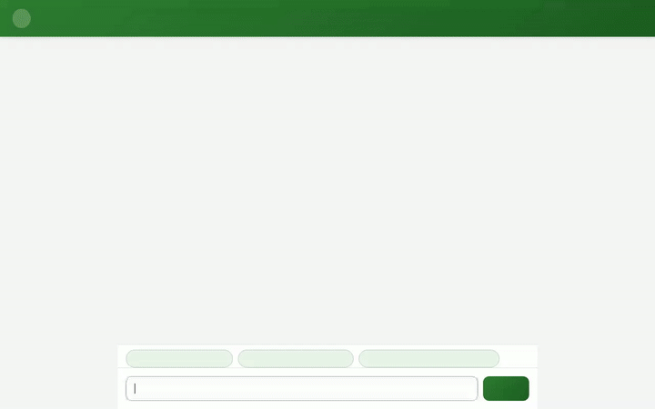

# Plant Care & Marketplace Assistant

An AI-powered assistant built with Google's **Agent Development Kit (ADK)**, **Vertex AI**, and **Google Cloud** infrastructure. The agent helps users manage houseplant inventories, calculate custom watering schedules, search for nearby plant nurseries, generate AI plant images and videos, and preserve user preferences and health sensitivities across sessions.



---

## Key Features & Capabilities

* 🌿 **Houseplant Inventory (Cloud Firestore)**: Full CRUD operations for managing houseplant records (`list_plants`, `get_plant_details`, `add_plant`, `update_plant_care`) stored in Google Cloud Firestore.
* 🎨 **AI Image Generation**: Generates high-definition plant imagery using `gemini-3.1-flash-lite-image` on Vertex AI (`global` region), saved as ADK artifacts and stored in a public Cloud Storage bucket.
* 📹 **AI Video Generation**: Produces short botanical videos using Google's Omni model (`gemini-omni-flash-preview`) via the Vertex AI Interactions API in the `global` region, saving artifacts and hosting them on Cloud Storage.
* 🧠 **Memory Bank Integration**: Persists user preferences, plant health notes, and allergy sensitivities across chat sessions using `PreloadMemoryTool` and callback hooks.
* 📱 **Structured A2UI Interface**: Delivers dynamic, structured component cards (Cards, Columns, Rows, Text, Images) for clean visual display of plant catalog items and nurseries.
* 📍 **Nursery & Florist Discovery**: Converts addresses to geographic coordinates (`geocode_address`) and locates nearby nurseries using the Google Places API (`find_nearby_places`).
* 💧 **Watering Schedule Calculator**: Calculates environment-specific watering frequencies based on light levels, room humidity, pot size, and soil composition.

---

## Google Cloud Services Used

* **Vertex AI**: Powers agent reasoning (`gemini-flash-latest`), image generation (`gemini-3.1-flash-lite-image`), and video generation (`gemini-omni-flash-preview`).
* **Google Cloud Firestore**: Persists user houseplant inventory records.
* **Google Cloud Storage**: Hosts generated plant image and video assets with public URLs.
* **Google Places API**: Handles address geocoding and nearby nursery lookups.
* **Cloud Run**: Hosts the production web frontend proxy service.

---

## Repository Structure

```
.
├── app/
│   ├── agent.py                 # Main ADK agent definition, tools, and callbacks
│   └── __init__.py
├── frontend/
│   ├── main.py                  # FastAPI server proxying requests to Agent Engine
│   └── static/
│       ├── index.html           # Plant Care Assistant UI with dialogue layout
│       ├── css/
│       └── js/
├── agents-cli-manifest.yaml     # ADK deployment configuration manifest
├── pyproject.toml               # Python project configuration and dependencies
├── demo.gif                     # Demo recording of the assistant in action
└── README.md
```

---

## Local Setup & Running Instructions

### 1. Prerequisites
* Python 3.11+
* `uv` package manager installed
* Google Cloud SDK (`gcloud`) authenticated with vertexai and storage permissions

### 2. Environment Setup
Install project dependencies using `uv`:
```bash
uv sync
```

Set the required environment variables:
```bash
export AGENT_ENGINE_RESOURCE_NAME="projects/<YOUR_PROJECT_ID>/locations/us-east1/reasoningEngines/<YOUR_REASONING_ENGINE_ID>"
export AGENT_DIRECTORY="app"
```

### 3. Run the Agent Server Locally
Navigate to the `frontend` directory and start the FastAPI proxy server:
```bash
cd frontend
uv run python main.py
```
Open a browser and navigate to port `8080` on your local system to interact with the assistant.

### 4. Deploying Frontend to Cloud Run
To deploy the frontend proxy service to Cloud Run:
```bash
gcloud run deploy plant-care-frontend \
  --source ./frontend \
  --region us-east1 \
  --set-env-vars AGENT_ENGINE_RESOURCE_NAME="<YOUR_AGENT_ENGINE_RESOURCE_NAME>",AGENT_DIRECTORY="app" \
  --allow-unauthenticated
```
